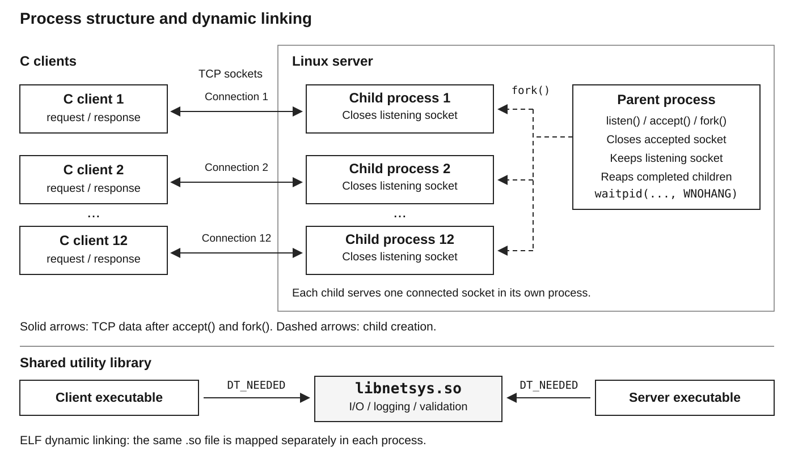
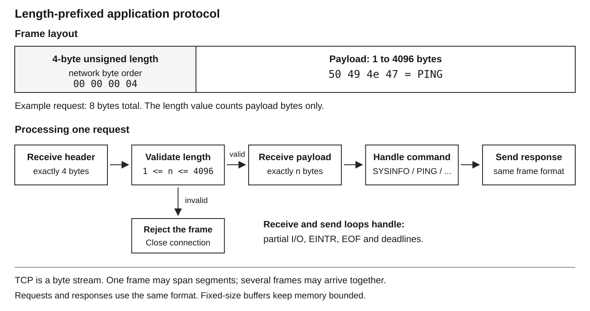
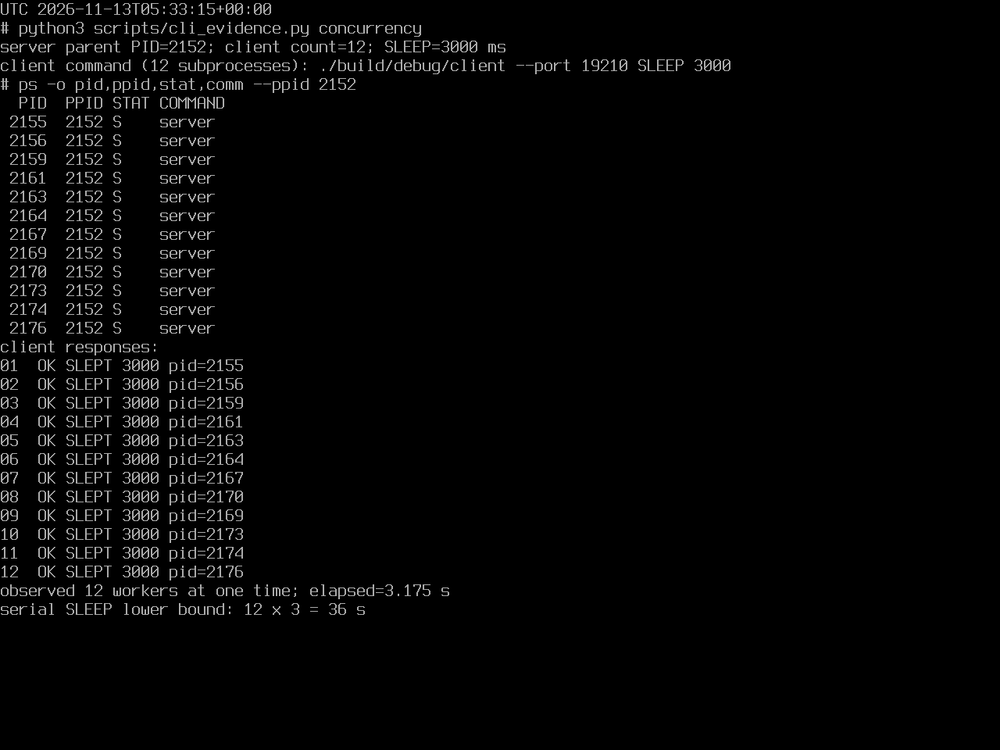

# ForkSysInfo

C TCP client/server assignment. The server calls `fork()` for each accepted connection; no threads are used. Both programs dynamically link `libnetsys.so`.

Public repository: [mimimaomao1117/forksysinfo](https://github.com/mimimaomao1117/forksysinfo)

- [English report PDF](report/ForkSysInfo_Report.pdf) and [report source](docs/REPORT.md)
- [Native command-line screenshots](media/cli/)
- [Latest packet capture](evidence-cli/loopback.pcap) and [test results](evidence-cli/results.json)
- [Two-minute English video](media/ForkSysInfo_2min.mp4), [English subtitles](media/ForkSysInfo_2min.en.srt), and [transcript](media/ForkSysInfo_2min_transcript.txt)
- [Classroom steps and spoken English script](docs/CLASSROOM_DEMO.md), [command cheat sheet](docs/CLASSROOM_COMMANDS.txt), and [teacher Q&A](docs/CLASSROOM_QA.md)

## Design

The parent accepts connections and starts one child per connection. A child can process several requests on the same TCP connection. The command-line client sends one request and exits after its response.



Each message has a four-byte unsigned network-order length, followed by 1 to 4096 bytes of text. The server supports `SYSINFO`, `PING`, `ECHO text`, `SLEEP ms`, and `QUIT`.



## Latest command-line run

The updated report uses a fresh run on Linux `6.12.117-0-virt`, GCC 14.2.0, tcpdump 4.99.5, and TShark 4.4.7 under QEMU software emulation.

| Check | Recorded result | Evidence |
|---|---|---|
| Full integration suite | 11 of 11 test groups passed | `evidence-cli/results.json` |
| Separate CLI concurrency demonstration | 12 workers alive together; all 12 C clients succeeded | `evidence-cli/console_results.json` |
| CLI timing | Twelve `SLEEP 3000` requests completed in 3.175 seconds | `evidence-cli/raw/console_concurrency.txt` |
| Packet capture | 4 TCP connections, 40 packets, 8 data segments, 0 resets; 3664-byte PCAP | `evidence-cli/loopback.pcap` |

The 36-second serial lower bound is `12 x 3 seconds`; it is a calculation, not a measured serial implementation. The full suite and the separate CLI demonstration have their own logs. PIDs and timings change when rerun.



`media/cli/` contains eight screenshots captured directly from the Linux virtual console. The original uncropped PNGs are retained; the report may omit unused blank space below their output. The English video narrates these screenshots and the same architecture and framing diagrams used in the report. It is a walkthrough of the recorded evidence. Earlier `evidence/`, `evidence-recheck/`, and the older dashboard screenshots remain reference material from earlier runs.

## Build and run on Linux

On Ubuntu or Debian:

```bash
sudo apt-get update
sudo apt-get install -y build-essential python3 tcpdump iproute2 binutils procps git
git clone https://github.com/mimimaomao1117/forksysinfo.git
cd forksysinfo
make DEBUG=1
make DEBUG=0
```

In one terminal:

```bash
./build/debug/server --host 127.0.0.1 --port 9090 --debug
```

In another terminal:

```bash
./build/debug/client --port 9090 SYSINFO
./build/debug/client --port 9090 PING
./build/debug/client --port 9090 ECHO "Hello from C"
./build/debug/client --port 9090 SLEEP 1000
```

The C programs can run as an ordinary user. `SYSINFO` reports the Linux environment visible to the server. The default listening address is loopback. Press Ctrl+C to stop the server and clean up its workers.

## Reproduce the tests and CLI evidence

The original full-test entry point writes to `evidence/`. Packet capture requires appropriate privileges; on native Linux use:

```bash
sudo bash scripts/run_all.sh
```

To create the separate evidence used by the revised report:

```bash
sudo python3 scripts/cli_evidence.py suite
```

This runs all 11 test groups, rebuilds debug and release, captures loopback packets, and writes `evidence-cli/results.json`. Individual demonstrations write their transcripts and measurements to `evidence-cli/raw/` and `evidence-cli/console_results.json`:

```bash
sudo python3 scripts/cli_evidence.py build
sudo python3 scripts/cli_evidence.py sysinfo
sudo python3 scripts/cli_evidence.py concurrency
sudo python3 scripts/cli_evidence.py robustness
sudo python3 scripts/cli_evidence.py debug-library
```

For the TShark demonstrations, install TShark and run the suite first so that `evidence-cli/loopback.pcap` exists:

```bash
sudo apt-get install -y tshark
sudo python3 scripts/cli_evidence.py tshark
sudo python3 scripts/cli_evidence.py tshark-hex
```

TShark is needed for those two analysis modes, not for the C programs or the original tcpdump test. The hex demonstration checks the PING frame bytes `0000000450494e47`. Rerunning a mode replaces its evidence files, so retain a separate copy if needed.

## Debug, library and abnormal conditions

`make DEBUG=1` retains debug calls in `build/debug/`. They print only when the program also receives `--debug`. `make DEBUG=0` produces `build/release/` with those calls removed. The observed four combinations produced 0, 8, 0 and 0 debug lines for the tested PING exchange.

```bash
ldd build/debug/server
ldd build/debug/client
readelf -d build/debug/server
```

Both executables require `libnetsys.so` and use `$ORIGIN` to find it beside the binary.

Normal operation handles partial I/O, deadlines, malformed frames, disconnects, bounded admission, child reaping, and shutdown. `--unsafe` disables the full receive loop, idle deadline, and active child reaping for comparison. Buffer bounds remain in place. The three paired tests show fragmented-request failure, an idle worker that remains blocked, and a zombie child in that comparison mode.

## Windows Docker or the complete desktop bundle

The public repository includes source, tests, documentation, reports, media, and evidence. It excludes `build/`, `portable-linux/`, and local `runs/`. Build the programs on Linux, or use a working Docker Desktop Linux backend from PowerShell:

```powershell
docker build -t forksysinfo .
docker run --rm --cap-add NET_RAW --cap-add NET_ADMIN -v "${PWD}:/project" forksysinfo bash scripts/run_all.sh
```

The Docker image contains the original suite's dependencies. Install TShark in the container if using the two extra TShark modes. Docker is an alternative reproduction route; the recorded screenshots were captured in QEMU Linux on this computer.

The complete desktop submission additionally contains QEMU and the Linux disk in `portable-linux/`. Only that bundle supports the Windows launchers directly:

1. Run `START_DEMO.cmd` to start Linux, update the C source, rebuild, and run the original suite. New exported results appear under `runs/<timestamp>/`.
2. Open two `LINUX_SHELL.cmd` windows for a manual demonstration. Run `sh scripts/demo.sh --server` in the first and `sh scripts/demo.sh` in the second.
3. Run `STOP_LINUX.cmd` when finished.

Keep the bundle's folder structure intact and allow about 2 GB free memory and 1 to 3 minutes to boot. The application is a loopback classroom demonstration and does not implement TLS or user authentication.
