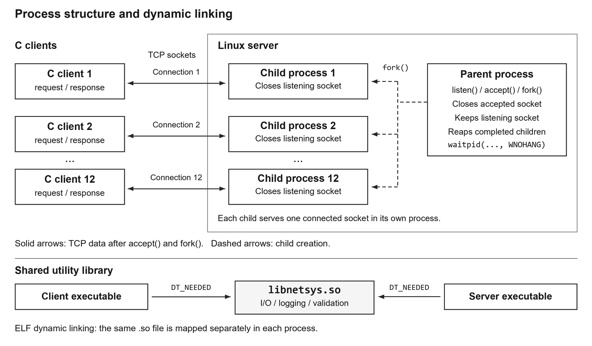
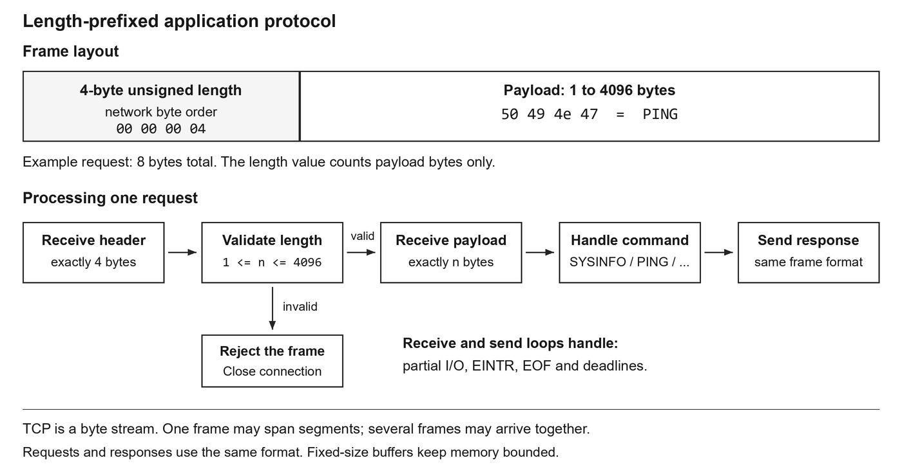
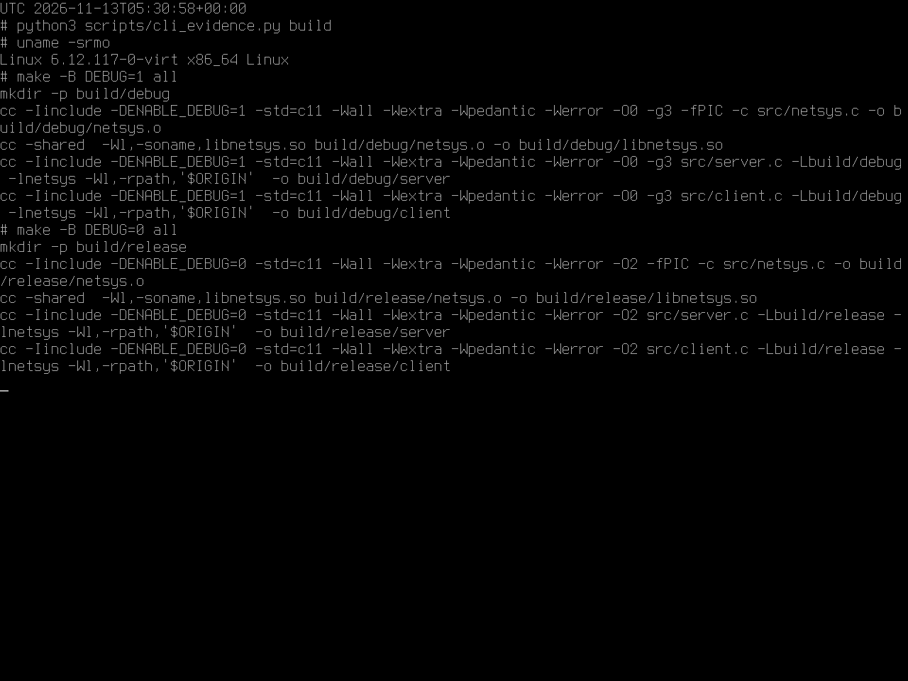
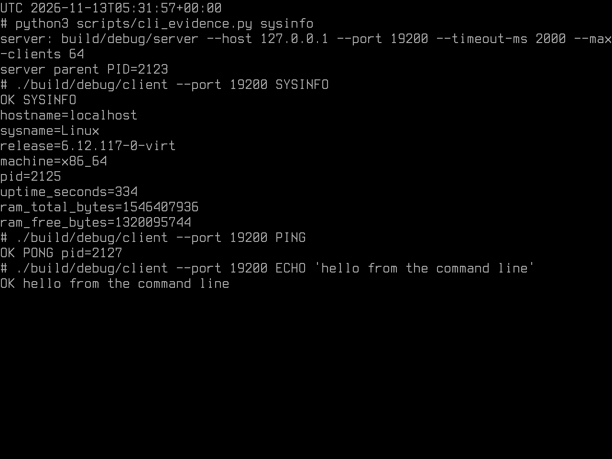
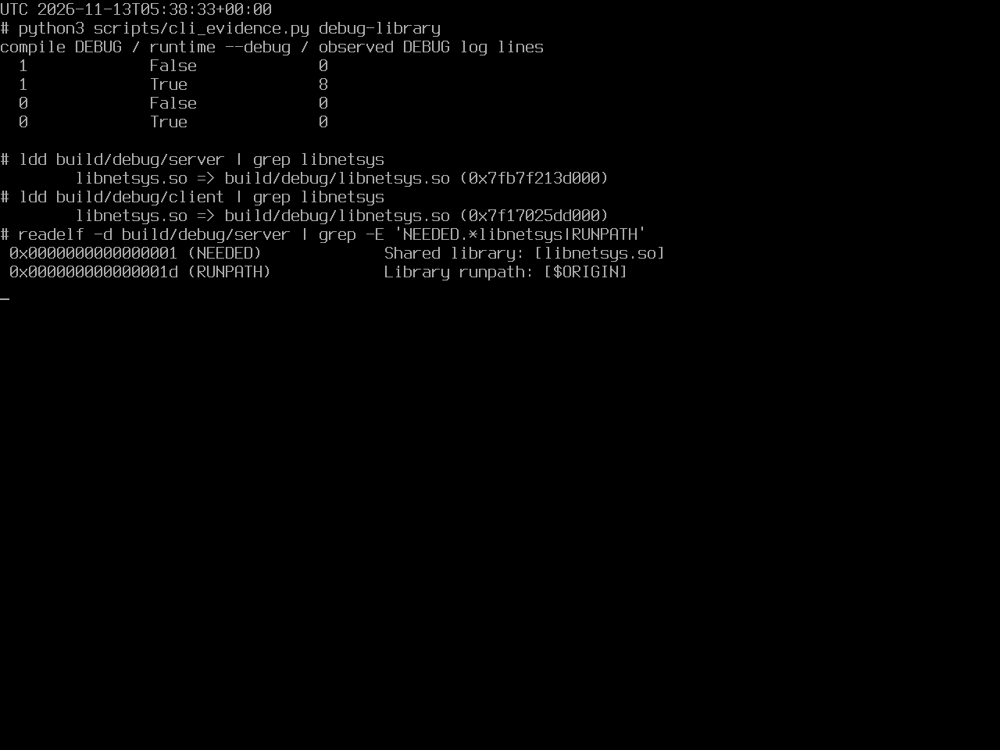
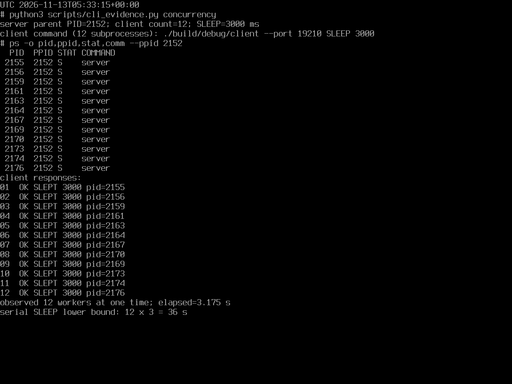
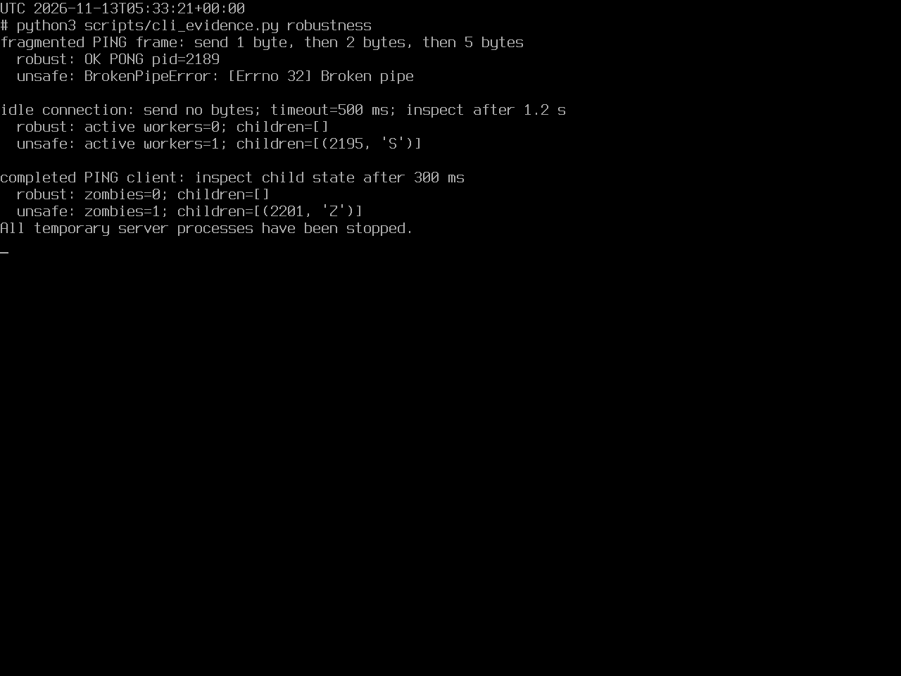
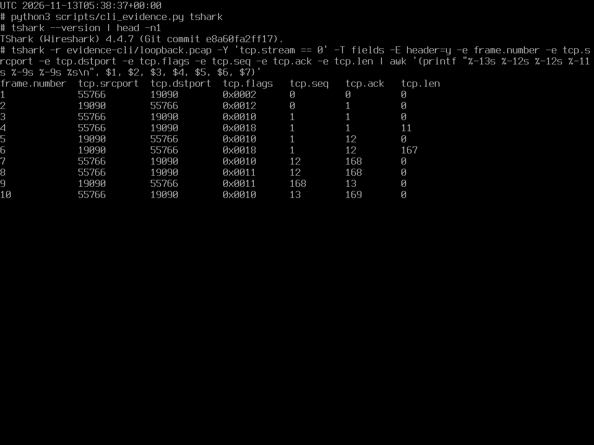
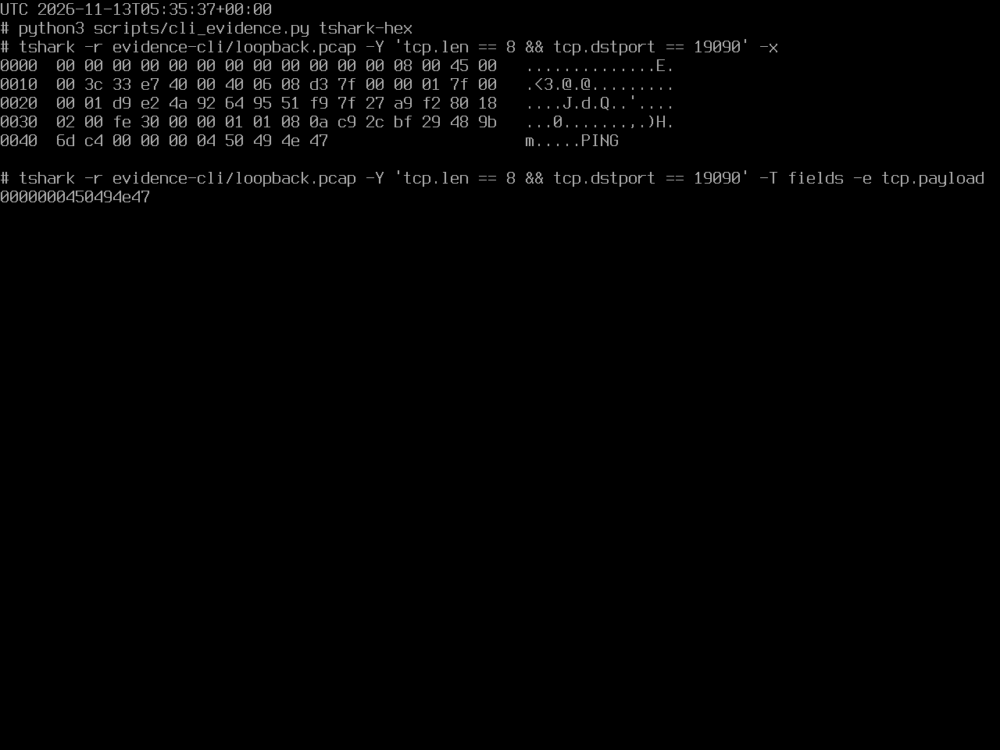
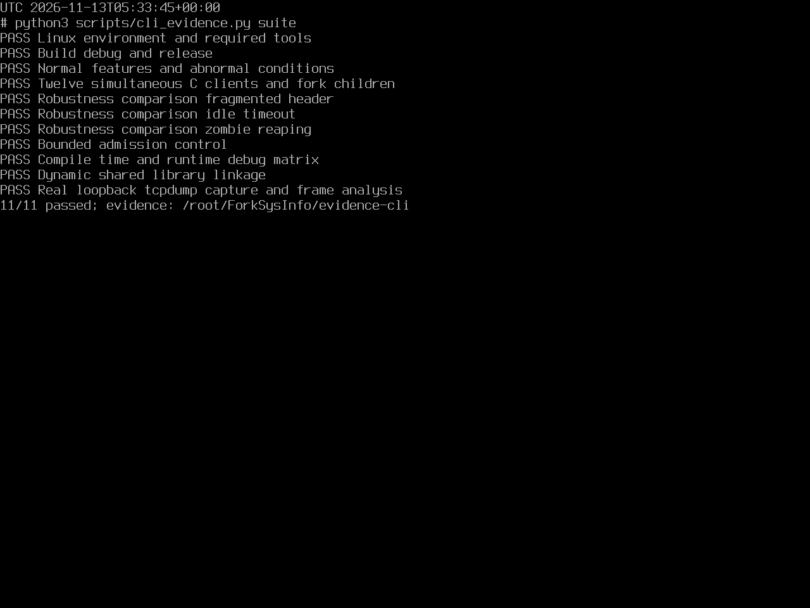

# ForkSysInfo TCP Client Server Lab Report

Repository: https://github.com/mimimaomao1117/forksysinfo

Date: November 13 2026

## 1 Test environment and features

This project implements a TCP system information service in C. The server uses `fork()` to create one child for each connection. No threads are used. The client and server both dynamically link `libnetsys.so`.

The program was tested in Linux under QEMU on the Windows computer used for this assignment. This command-line run uses Linux 6.12.117-0-virt, GCC 14.2.0, GNU Make 4.4.1, Python 3.12.16, tcpdump 4.99.5 and TShark 4.4.7. The screenshots are direct captures of the Linux virtual console, and their output is saved in `evidence-cli/`. Earlier records remain separately in `evidence/` and `evidence-recheck/`.

SYSINFO returns the Linux hostname, kernel, architecture, worker PID, uptime and memory information. PING checks the connection, ECHO returns text, SLEEP simulates work, and QUIT closes a session. SYSINFO reports what the Linux guest sees.

## 2 Server design and message format

The parent creates the listening socket and calls `accept()`. After each accepted connection, it calls `fork()`. The child handles that connection while the parent immediately returns to accepting more clients. The parent closes its copy of the connected socket, and the child closes its copy of the listening socket. The parent collects completed children with `waitpid(..., WNOHANG)`.



A child can process several requests on one TCP connection. It exits after QUIT, EOF or a frame error. The command-line client sends one request, prints one reply and then closes its connection.

TCP is a byte stream. One send does not necessarily correspond to one receive. Each application message therefore begins with a 4-byte unsigned length in network byte order, followed by 1 to 4096 payload bytes. The terminating C NUL is not sent. A PING request is `00 00 00 04 50 49 4e 47`.



The main source files are:

- `src/server.c`: `main()` accepts and forks; `serve_client()` runs the session; `handle_command()` selects the operation; `system_info()` calls uname, sysinfo and gethostname.
- `src/client.c`: parses the options, connects, sends one request and displays the response.
- `src/netsys.c`: implements shared framing, socket setup, deadlines, numeric validation and logging. `include/netsys.h` declares the interface and debug macro.
- `Makefile`: builds the shared library and both executables in separate debug and release directories.

## 3 Build and system information request

The Makefile enables `-Wall -Wextra -Wpedantic -Werror`, so a compiler warning fails the build.

```bash
make DEBUG=1
make DEBUG=0
```



Start the server in one terminal and run the client in another:

```bash
./build/debug/server --port 9090 --debug
./build/debug/client --port 9090 SYSINFO
./build/debug/client --port 9090 ECHO "Hello from C"
```

The PID in a SYSINFO response belongs to the child handling that connection. A new client connection normally receives a different worker PID. SLEEP accepts an integer from 0 to 10000 milliseconds.



## 4 Shared library and debug controls

The shared code is compiled with `-fPIC` and linked as `libnetsys.so`. Both executables use `-lnetsys`. Their RUNPATH contains `$ORIGIN`, so they find the library beside the executable without changing the system library path.

```bash
ldd build/debug/client
ldd build/debug/server
readelf -d build/debug/server
```

The compile-time `ENABLE_DEBUG` macro determines whether debug calls exist in the binary. The runtime `--debug` option controls whether those calls print anything. Startup, lifecycle and error messages remain available.

| Build setting | Runtime option | Debug output |
|---|---|---|
| DEBUG=1 | No --debug | No |
| DEBUG=1 | With --debug | Yes |
| DEBUG=0 | No --debug | No |
| DEBUG=0 | With --debug | No |

The command-line PING test produced 0, 8, 0 and 0 debug lines for these four combinations. Eight is the combined client and server count for that transaction, rather than a fixed count for every command. Separate `build/debug/` and `build/release/` directories prevent objects compiled with different settings from being mixed.



## 5 Twelve concurrent clients

The standalone command-line test launches 12 C clients together on port 19210. Each requests SLEEP 3000. While the requests overlap, ps and ss record the worker processes and established TCP connections. The test then checks every client's exit status and reply.

```bash
python3 scripts/cli_evidence.py concurrency
```

The snapshot shows 12 distinct workers under parent PID 2152. All clients received `OK SLEPT 3000` and exited with status 0. Total elapsed time was 3.175 seconds. Sequential waiting alone would take at least 12 times 3 seconds, or 36 seconds. The overlapping workers are the main concurrency proof; twelve successful lines alone would also be possible with sequential execution.



On loopback, ss can display both endpoints of each connection. Twenty-four endpoints therefore do not mean twenty-four clients.

## 6 Abnormal conditions and paired tests

Normal mode handles partial I/O, EINTR, EOF, read and write deadlines, and SIGPIPE. It checks frame lengths and command arguments before using them. A frame deadline uses a monotonic clock and is not restarted whenever another byte arrives. The parent defaults to a limit of 64 workers and cleans up remaining children when it shuts down.

For comparison, `--unsafe` disables complete receive loops, receive deadlines and normal child reaping. Buffer limits remain enabled. Each paired test uses the same input, and the test harness cleans up both modes afterwards.

| Test | Normal mode | --unsafe mode |
|---|---|---|
| Send the PING frame in 1, 2 and 5-byte fragments | Reads the full frame and replies | Short header causes the connection to fail |
| Connect without sending data; deadline 500 ms | Worker exits after the deadline | Worker keeps waiting |
| Complete PING and close the client | Parent reaps the worker | Worker remains in state Z |

In the command-line run, fragmented PING returned `OK PONG pid=2189` normally; a later write in unsafe mode reported Broken pipe. After 1.2 seconds, the idle worker counts were 0 and 1. The unsafe worker remained in state S. After completing PING, the zombie counts were 0 and 1, with unsafe worker PID 2201 in state Z. The 1.2 seconds was the observation time, while the configured deadline was 500 ms.



Other checks cover length 0, 4097 and UINT32_MAX, embedded NUL, truncated payload, invalid commands and SLEEP arguments, peer reset, occupied port and refused connection. An admission test sets the worker limit to 2 and checks that the third connection receives SERVER_BUSY.

## 7 Packet capture and analysis

Tcpdump captures traffic on the Linux loopback interface. TShark reads the saved PCAP to show TCP flags, sequence and acknowledgment numbers, and payload bytes.

```bash
tcpdump -i lo -nn -s 0 -U \
  -w evidence-cli/loopback.pcap 'tcp port 19090'
tshark -r evidence-cli/loopback.pcap -Y 'tcp.stream == 0'
tshark -r evidence-cli/loopback.pcap \
  -Y 'tcp.len == 8 && tcp.dstport == 19090' -x
```



The fresh `evidence-cli/loopback.pcap` is 3664 bytes and contains 4 connections and 40 packets. Eight packets carry application data, and no RST is present. Eight SYN flags include four SYN requests and four SYN ACK replies. Eight FIN flags represent the normal closing of the four connections. The requests are SYSINFO, PING, ECHO and SLEEP 50.

For TCP stream 0, frames 1 to 3 are the handshake. Frame 4 carries an 11-byte SYSINFO request: a 4-byte prefix and 7-byte command. Frame 6 carries 167 bytes: the prefix `00 00 00 a3` and a 163-byte system information response. Frames 8 to 10 close this connection with FIN ACK, FIN ACK and the final ACK.

PING begins with `00 00 00 04`, followed by `50 49 4e 47`. SYSINFO begins with `00 00 00 07`. TCP segments and application frames need not have matching boundaries. Reassembly must follow direction and sequence numbers before the application length is decoded. ACK advancement covers both the 4-byte prefix and payload; SYN and FIN each consume one additional sequence number.



## 8 Reproduction and classroom demonstration

The public repository includes source, tests, reports, video, screenshots and reference packet records. Git excludes `build/`, `portable-linux/` and `runs/`. On Ubuntu or Debian:

```bash
sudo apt-get update
sudo apt-get install -y build-essential python3 tcpdump tshark iproute2 binutils procps git
git clone https://github.com/mimimaomao1117/forksysinfo.git
cd forksysinfo
sudo bash scripts/run_all.sh
```

The complete test needs capture permission, which is why the command uses sudo. Ordinary client and server requests can run as a normal user.

The full desktop bundle also includes offline Linux. `START_DEMO.cmd` updates the C source, rebuilds and runs the tests, then exports new evidence to `runs/<timestamp>/`. For a manual demonstration, open two `LINUX_SHELL.cmd` windows and run `sh scripts/demo.sh --server` in one and `sh scripts/demo.sh` in the other. Finish with `STOP_LINUX.cmd`. A plain GitHub clone does not include the runtime required by those Windows launchers.

The two-minute video is `media/ForkSysInfo_2min.mp4`. Complete C source and the Makefile are included in the report appendix and supplied as editable files. The demonstration uses loopback and does not implement TLS or user authentication.

## 9 Complete integration run

The complete suite passed all 11 test groups on Linux 6.12.117. It checks both builds, normal features, malformed input, concurrency, three robustness comparisons, admission control, debug output, shared-library linkage and actual loopback capture. The full result is `evidence-cli/results.json`.



The suite launches its own temporary processes. Its PIDs and timings are separate from the standalone SLEEP 3000 demonstration in Section 5. That demonstration and the other console examples are indexed in `evidence-cli/console_results.json`, with the command output in `evidence-cli/raw/`.

Full uncropped console PNG files are supplied in `media/cli/`. The PDF layout omits only unused terminal space below the output.

## References

1. Linux man-pages fork(2): https://man7.org/linux/man-pages/man2/fork.2.html
2. Linux man-pages waitpid(2): https://man7.org/linux/man-pages/man2/waitpid.2.html
3. Linux man-pages tcp(7): https://man7.org/linux/man-pages/man7/tcp.7.html
4. Tcpdump manual: https://www.tcpdump.org/manpages/tcpdump.1.html
5. GNU Make manual: https://www.gnu.org/software/make/manual/make.html
